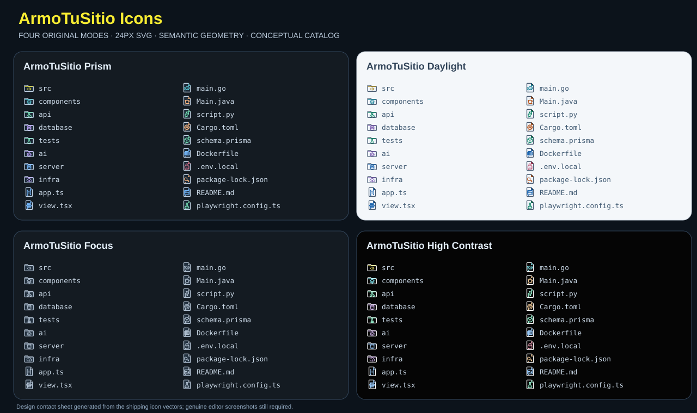

# ArmoTuSitio Icons

**File and folder iconography redesigned for clarity, speed of recognition and visual consistency.**

[](https://github.com/Drako01/icons/actions/workflows/ci.yml)   



> **Preview 0.1.0.** This is a **generated vector contact sheet**, not a VS Code screenshot. Actual editor screenshots are pending manual review. **Not published** to VS Code Marketplace or Open VSX.

[Español](#español) · [English](#english) · [QA](#calidad-y-mantenimiento--quality--maintenance)

## Español

### Identidad propia, no otra copia

La propuesta es reconocer archivos rápidamente sin convertir el Explorer en un arcoíris de logos. Los **77 tipos de archivo y 44 tipos de carpeta** comparten una geometría original de 24×24 px: silueta clara, pliegue distintivo, trazo estable y acento semántico. El catálogo cubre **168 asociaciones por extensión, 94 nombres exactos de archivo y 112 asociaciones de carpeta**, más lenguajes.

El núcleo es **100% declarativo**: no tiene proceso residente, telemetría, comandos invasivos, dependencias de runtime, consumo de red ni modificación de preferencias.

### Cuatro variantes incluidas

| Variante | Para qué sirve |
|---|---|
| **ArmoTuSitio Prism** | El diseño principal: midnight corporativo, acentos semánticos y carácter premium |
| **ArmoTuSitio Daylight** | Contraste ajustado para un editor de fondo claro |
| **ArmoTuSitio Focus** | Un solo color para reducir distracción en árboles complejos |
| **ArmoTuSitio High Contrast** | Contornos blancos y acentos intensos; pendiente validación manual de accesibilidad |

Todas incorporan carpetas abiertas/cerradas diferenciadas, iconos para la raíz del workspace y asociaciones específicas de carpeta. VS Code conserva sus flechas de expansión para no depender únicamente del color.

### Cobertura pensada para proyectos reales

- Backend: Go, Java, Python, PHP, Rust, Kotlin, C#, C++, Ruby, SQL y bases de datos.
- Web: JavaScript/TypeScript, JSX/TSX, React, Vue, Angular, Svelte, Astro, Next, HTML/CSS y Markdown.
- Infraestructura y QA: Docker, Terraform, Git, CI, tests, Prisma, GraphQL, lockfiles y configuraciones.
- Proyectos modernos: `go.mod`, `pom.xml`, `package.json`, `pnpm-lock.yaml`, `schema.prisma`, `Dockerfile`, `vite.config.ts`, `angular.json`, `tsconfig.json`, `.env.local` y muchos más.
- Carpetas: `src`, `components`, `api`, `server`, `database`, `tests`, `infra`, `.github`, `agents`, `auth`, `migrations`, `workers`, `cache`, `services`, `public`, etc.

**Precisión:** VS Code no admite patrones arbitrarios en `fileNames`. El generador define los nombres más frecuentes y utiliza asociaciones por extensión para `*.test.ts`, `*.spec.ts`, etc. Un candado en `.env` es una advertencia visual, **no un analizador de secretos**. Los nombres desconocidos conservan un fallback original.

### Instalación para probar la versión Preview

1. Abrí [GitHub Actions → Icon CI](https://github.com/Drako01/icons/actions/workflows/ci.yml).
2. Descargá `validated-vsix` de un PR que haya pasado CI.
3. Extraé `armotusitio-icons-0.1.0.vsix` y su `.sha256`; verificá la integridad.
4. En VS Code: **Extensions → … → Install from VSIX…**.
5. Ejecutá **Preferences: File Icon Theme** y elegí una variante de ArmoTuSitio.

```powershell
code --install-extension .\armotusitio-icons-0.1.0.vsix
```

Los iconos se activan **solo si los seleccionás**. La extensión no modifica `settings.json` ni sobrescribe los temas nativos de ArmoTuSitio IDE.

### Qué no prometemos todavía

El resultado visual debe comprobarse a **16 px reales** en Windows, macOS, Linux y ArmoTuSitio IDE, con fondos claros/oscuros, pantallas HiDPI y proyectos grandes. Los tests validan integridad y cobertura, **no certifican accesibilidad integral**. No contamos aún con experimentos de reconocimiento/retención que justifiquen afirmar que es la mejor extensión del mercado. La siguiente fase debe medir esas métricas con usuarios reales.

## English

### Original icon language, engineered for actual work

Four opt-in modes, 24px authored SVGs (optimized for small tree icons), semantic visual roles, open/closed folder pairs, and broad file/folder associations for modern full-stack, backend and AI workspaces.

**No extension host:** this extension contributes icon theme JSON and local SVG assets only. No activation script, background work, telemetry, HTTP requests or runtime dependencies. The source generator is an offline developer/build tool; it is **not included in the VSIX**.

**Install:** download `validated-vsix` from a successful PR CI run, check the SHA-256, install from VSIX, then select a mode with **Preferences: File Icon Theme**. For ArmoTuSitio IDE, verify against an actual build.

**Important:** this release is a preview. Genuine editor screenshots, readability tests and controlled comparisons against established packs remain release gates. Competing icon projects are functional benchmarks; their SVG art is **not copied**.

## Calidad y mantenimiento / Quality & maintenance

```bash
npm run build       # deterministic SVG + theme JSON generation, no external dependencies
npm run check       # build + structural, association, safety and quality tests
npm run package     # builds then packages the exact preview VSIX
python3 scripts/verify-vsix.py dist/armotusitio-icons-0.1.0.vsix
```

The `ci.yml` PR matrix checks **Ubuntu, Windows and macOS**, then packages the VSIX once and produces `validated-vsix` with SHA-256. Merge does not repeat CI. The extension is not automatically published.

| Documentation | Scope |
|---|---|
| [Benchmark competitivo](docs/BENCHMARK.md) | Evidence-based assessment of leading icon packs |
| [Sistema visual](docs/DESIGN.md) | Original geometric language, palette and design tradeoffs |
| [Criterios de aceptación](docs/ACCEPTANCE.md) | Visual/manual checks still required |
| [Publicación](docs/PUBLISHING.md) | Safe first-release policy |

MIT covers the original icon art and source. The unchanged corporate ArmoTuSitio glyph is provided by its owner; the MIT grant does not transfer corporate trademark rights.
